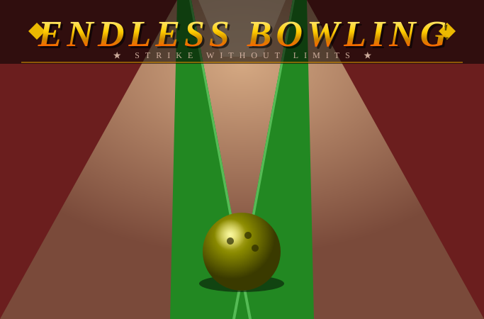

# 🎳 Endless Bowling

**Endless Bowling** is a 3D endless runner game where you control a continuously rolling bowling ball, dodge incoming obstacles, and collect spinning bowling pins to beat your high score.

This is my **first game**, built as a hands-on project to learn **Unity** and get familiar with its core systems—including physics, procedural spawning, UI, audio, scene management, and local data persistence.

👉 **Play / Download on itch.io:** [Endless Bowling by takumi_ji](https://takumi-ji.itch.io/endless-bowling)



---

## ✨ Features

- **Endless Rolling Gameplay:** The ball rolls forward continuously along an infinitely looping lane (`InfiniteGround`), constrained within lane boundaries so you stay on track.
- **Dynamic Obstacle & Pin Generation:** Obstacles and spinning bowling pins spawn procedurally ahead of the player (`ObstacleGenerator`) at randomized lane positions and heights, with overlap checks to keep pins reachable.
- **Jump & Dodge Mechanics:** Steer left/right and jump over obstacles or reach floating bowling pins using Unity's `Rigidbody` physics.
- **Score & High Score Persistence:** Tracks collected pins (`PINS`) in real time and saves your best run (`HIGHSCORE`) locally via `PlayerPrefs`.
- **Audio & Volume Settings:** Features background music, pin collection sound effects, and an Options menu with a persistent master volume slider (`AudioListener.volume` + `PlayerPrefs`).
- **Complete Scene Flow:** Includes `MainMenu`, Gameplay (`1`), `Option`, and `GameOver` scenes.

---

## 🎮 Controls

| Action | Key |
| :--- | :--- |
| Move Left / Right | `A` / `D` or `←` / `→` |
| Jump | `Space` |

---

## 🛠️ Tech Stack & Unity Systems Practiced

- **Engine:** Unity `6000.3.11f1` (Unity 6)
- **Language:** C#
- **Render Pipeline:** Universal Render Pipeline (URP)
- **Packages Used:** Cinemachine, TextMesh Pro (uGUI), Unity Input System
- **Core Unity Concepts Learned:**
  - `Rigidbody` movement, jumping with ground collision checks, and boundary clamping
  - Trigger colliders (`OnTriggerEnter`) for collectibles, obstacle hitboxes, and infinite ground recycling
  - Prefab instantiation & procedural spawning (`Instantiate`)
  - Singleton pattern (`ScoreManagement`)
  - Scene transitions (`SceneManager`)
  - Local save data (`PlayerPrefs` for high score and audio volume)

---

## 📂 Project Structure

```text
Assets/
├── Audio/          # Background music & casual SFX packs
├── Images/         # Game banner & screenshots
├── Material/       # Materials for Ball, Pin, Ground, Obstacle, and Barrier
├── Prefab/         # Player, Ground, Obstacle, and Pin prefabs
├── Scenes/         # MainMenu, 1 (Gameplay), Option, GameOver
└── Script/
    ├── PlayerMovement.cs      # Forward roll, horizontal steering, jump, lane clamping
    ├── ObstacleGenerator.cs   # Procedural obstacle & pin spawning
    ├── InfiniteGround.cs      # Seamless ground recycling trigger
    ├── Collectible.cs         # Pin rotation, pickup SFX, and score increment
    ├── ObsitcalHitbox.cs      # Collision detection leading to Game Over
    ├── ScoreManagement.cs     # Score & High Score UI + PlayerPrefs persistence
    ├── MainMenu.cs            # Scene navigation (Play, Restart, Option, Menu, Quit)
    └── VolumeSlider.cs        # Master volume control saved with PlayerPrefs
```

---

## 🚀 Running the Project Locally

1. Clone this repository:
   ```bash
   git clone <your-repository-url>
   ```
2. Open **Unity Hub** and add the project folder.
3. Open the project using **Unity 6000.3.11f1** (or a compatible Unity 6 version).
4. Open `Assets/Scenes/MainMenu.unity` and press **Play**.

---

## 🎵 Audio Credits

- **SFX:** Casual Game Sounds U6
- **Music:** Free Casual Music Pack (*Running Wild*)

---

## 👤 Author

Made by **takumi_ji** — [itch.io](https://takumi-ji.itch.io/endless-bowling)
